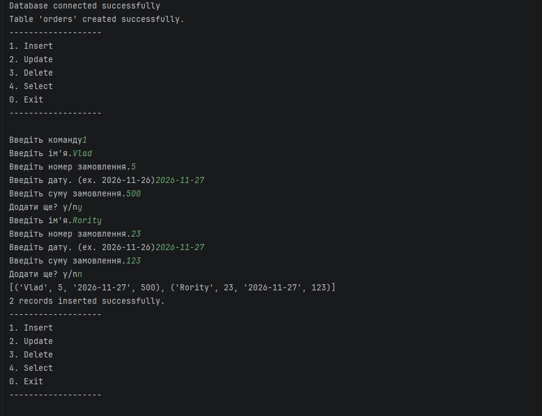
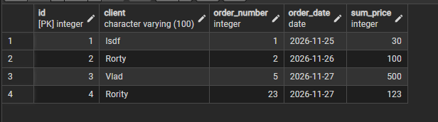

# Звіт до лабораторної роботи № 8

**Тема:** Підключення до бази даних та виконання основних операцій.

**Мета:** здобути практичні навички роботи з базами даних у мові програмування Python, навчитися виконувати базові операції (створення, вставка, оновлення, видалення, вибірка) та ознайомитися з принципами роботи з SQL.

---

## Хід роботи

### 1. Скріншоти виконання

*Додайте сюди скріншоти, що демонструють:*
1.  *Створення таблиці у вашій СУБД (наприклад, у pgAdmin).*
2.  *Результат виконання вашого Python-скрипта в терміналі.*
3.  *Вміст таблиці після виконання всіх операцій (SELECT запит у вашій СУБД).*

**

**

### 2. Контрольне запитання

*Вкажіть номер вашого варіанту та дайте розгорнуту відповідь на контрольне запитання.*

**Мій варіант:** `18`

**Питання:** `Що таке шардинг в базах даних? Як він допомагає масштабувати бази даних?`

**Відповідь:**
`Шардинг - це спосіб розподілу навантаження між декількома серверами / дата-базами. Він забезпечує горизонтальне масштабування, тобто можливість збільшувати продуктивність системи шляхом додавання нових серверів.` 

---

## Висновки

`Під час написання цієї лабораторної роботи я дізнався як використовувати SQL та як в загалі з ним 'комунікувати'. Зі складного було зрозуміти, що взагалі коїться в програмі.`
